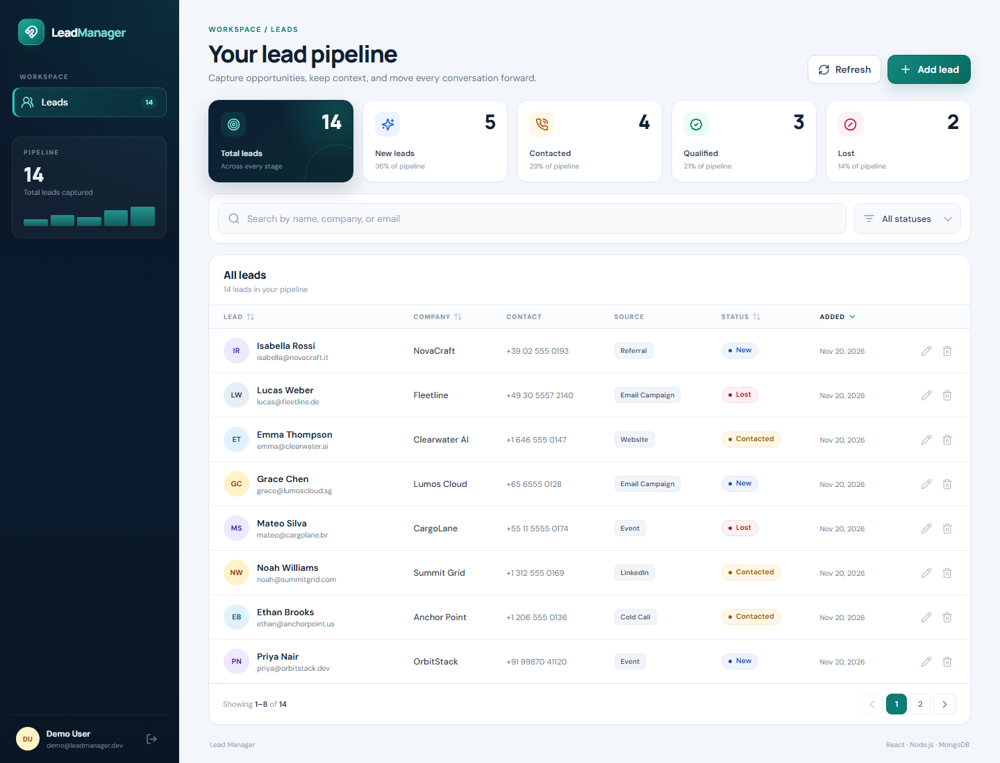
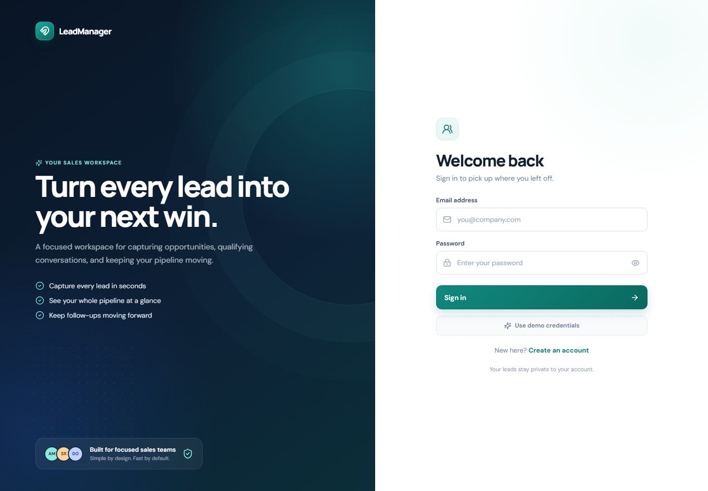

# Lead Manager

A small full-stack lead management application for sales teams. It lets a user capture leads, track their status, search and filter the pipeline, and keep each account's data private.

Built for the Meru Technosoft Full Stack Developer screening assignment.



<details>
<summary>View the sign-in screen</summary>



</details>

## Features

### Required features

- Add a lead with name, email, phone, company, source, and status.
- View all leads in a clear table with status badges.
- Edit lead details and update status.
- Delete a lead with a confirmation step.
- Search by name, company, or email.
- Filter by status.
- Frontend and backend validation for required fields, email, phone, and allowed enum values.

### Bonus features included

- Email/password authentication with JWT.
- Per-user lead isolation. Users only see their own leads.
- Pagination, sorting, and page-size controls at the API level.
- Dashboard cards showing total leads and counts per status.
- Automated API tests covering auth, CRUD, ownership isolation, search, filtering, sorting, pagination, and stats.
- Seed script with realistic demo data.
- Responsive layout with dedicated mobile lead cards, loading states, empty states, and error handling.

### Not included

- A live deployment link. The app is deployment-ready but has not been deployed from this workspace.

## Tech stack

| Layer | Choice |
| --- | --- |
| Frontend | React 18, Vite, React Router, Axios, Lucide icons, custom CSS |
| Backend | Node.js, Express 4 |
| Database | MongoDB with Mongoose |
| Auth | JWT, bcryptjs |
| Validation | express-validator on the API, custom validation in React |
| Tests | Node's built-in test runner plus Supertest |

The requested stack was React, Node.js, and MongoDB. I used JavaScript rather than TypeScript to keep the submission focused and fully complete within the expected effort.

## Project structure

```text
Assignment/
  client/                  React application
    src/
      api/                 Axios client and token storage
      components/          Auth shell, layout, table, modal, dialogs, toasts
      context/             Auth context
      hooks/               Toast hook
      pages/               Login, register, and leads pages
      utils/               Formatting, constants, validation
  server/                  Express API
    src/
      config/              Environment and MongoDB connection
      controllers/         Auth and lead handlers
      middleware/          Auth, validation, and error handling
      models/              User and Lead schemas
      routes/              Auth and lead routes
      seed.js              Demo data seeder
    tests/                 API integration tests
  docs/                    README screenshots
```

## Quick start

### Prerequisites

- Node.js 20 or newer
- npm 10 or newer
- MongoDB running locally on `mongodb://127.0.0.1:27017` (or an Atlas connection string)

### 1. Install dependencies

```bash
npm install
```

### 2. Configure the server

Copy the example environment file:

```bash
cp server/.env.example server/.env
```

Windows PowerShell:

```powershell
Copy-Item server/.env.example server/.env
```

Then update `server/.env`. At minimum, replace `JWT_SECRET` with a long random value.

Generate one with:

```bash
node -e "console.log(require('crypto').randomBytes(48).toString('hex'))"
```

The defaults in `server/src/config/env.js` are only intended for local development.

### 3. Seed demo data (optional)

```bash
npm run seed
```

This creates or resets the demo account and its leads:

```text
Email:    demo@leadmanager.dev
Password: Demo@1234
```

Re-running the seed script deletes and recreates only the demo user's leads.

### 4. Run the app

```bash
npm run dev
```

- Frontend: http://localhost:5173
- API: http://localhost:5000
- Health check: http://localhost:5000/api/health

Vite proxies `/api` requests to the Express server during development.

## Environment variables

### `server/.env`

| Variable | Default | Purpose |
| --- | --- | --- |
| `PORT` | `5000` | API port |
| `MONGODB_URI` | `mongodb://127.0.0.1:27017/lead-manager` | MongoDB connection string |
| `JWT_SECRET` | Local fallback | Secret used to sign JWTs |
| `JWT_EXPIRES_IN` | `7d` | JWT lifetime |
| `CLIENT_ORIGIN` | `http://localhost:5173` | Allowed CORS origin, comma-separated if multiple |
| `NODE_ENV` | `development` | Runtime mode |

### `client/.env`

| Variable | Default | Purpose |
| --- | --- | --- |
| `VITE_API_URL` | `/api` | API base URL used by Axios |

For local development the default `/api` works through the Vite proxy. For a separately hosted frontend, set `VITE_API_URL` to the full API URL.

## Scripts

Run these from the repository root:

| Script | Description |
| --- | --- |
| `npm run dev` | Run the API and Vite dev server together |
| `npm run build` | Build the React app into `client/dist` |
| `npm start` | Start the API server |
| `npm run seed` | Recreate demo data |
| `npm test` | Run API integration tests |
| `npm run check` | Build the frontend and run the API tests |

## API overview

All lead routes require:

```http
Authorization: Bearer <token>
```

### Auth

| Method | Endpoint | Description |
| --- | --- | --- |
| `POST` | `/api/auth/register` | Create an account and return a token |
| `POST` | `/api/auth/login` | Sign in and return a token |
| `GET` | `/api/auth/me` | Return the current user |

Register body:

```json
{
  "name": "Demo User",
  "email": "demo@leadmanager.dev",
  "password": "Demo@1234"
}
```

Passwords must contain at least 8 characters, including a letter and a number.

### Leads

| Method | Endpoint | Description |
| --- | --- | --- |
| `GET` | `/api/leads` | List, search, filter, sort, and paginate leads |
| `GET` | `/api/leads/stats` | Total count and counts by status |
| `POST` | `/api/leads` | Create a lead |
| `GET` | `/api/leads/:id` | Get one lead |
| `PATCH` | `/api/leads/:id` | Update one or more fields |
| `DELETE` | `/api/leads/:id` | Delete a lead |

List query parameters:

| Parameter | Values | Default |
| --- | --- | --- |
| `search` | Name, company, or email fragment | Empty |
| `status` | `New`, `Contacted`, `Qualified`, `Lost` | All |
| `page` | Positive integer | `1` |
| `limit` | `1`–`50` | `8` |
| `sort` | `name`, `company`, `status`, `createdAt`, `updatedAt` | `createdAt` |
| `order` | `asc`, `desc` | `desc` |

Create/update body:

```json
{
  "name": "Aarav Mehta",
  "email": "aarav@northstar.io",
  "phone": "+91 98100 24518",
  "company": "Northstar Labs",
  "source": "Website",
  "status": "New"
}
```

Allowed sources: `Website`, `Referral`, `LinkedIn`, `Cold Call`, `Email Campaign`, `Event`, `Other`.

Allowed statuses: `New`, `Contacted`, `Qualified`, `Lost`.

Successful list response:

```json
{
  "data": [],
  "pagination": {
    "page": 1,
    "limit": 8,
    "total": 0,
    "totalPages": 1
  }
}
```

Validation failures return `422` with field-level errors:

```json
{
  "message": "Please check the highlighted fields.",
  "errors": [
    { "field": "email", "message": "Enter a valid email address." }
  ]
}
```

Malformed IDs return `400`, missing or unauthorized resources return `401`/`404`, and duplicate accounts return `409`.

## Data model

### User

- `name`
- `email` — unique, lowercased, indexed
- `passwordHash` — excluded from queries by default
- `createdAt`, `updatedAt`

### Lead

- `owner` — indexed reference to `User`
- `name`
- `email`
- `phone`
- `company`
- `source` — enum
- `status` — enum
- `createdAt`, `updatedAt`

Indexes:

- `{ owner: 1, status: 1, createdAt: -1 }` for filtered, sorted list queries.
- `{ owner: 1, name: 1 }` for owner-scoped name ordering.
- `{ owner: 1, email: 1 }` for owner-scoped email lookups.

Every lead query includes `owner: req.user.id`, including detail, update, and delete operations. This prevents one user from accessing another user's records.

## Testing

The tests use a separate local database called `lead-manager-test` and drop it after the run. MongoDB must be running.

```bash
npm test
```

Coverage includes:

- Health check.
- Registration validation, password hashing, duplicate-email handling, and token issuance.
- Login failure and success.
- JWT-protected routes.
- Lead create, read, update, and delete.
- Validation errors for bad email, status, empty updates, and malformed IDs.
- Per-user data isolation.
- Search, status filtering, sorting, pagination, and status counts.

## Production build

Build the frontend, then run Express with `NODE_ENV=production`. Express serves the built SPA from `client/dist` and handles client-side routing.

```bash
npm run build
```

PowerShell:

```powershell
$env:NODE_ENV="production"
npm start
```

macOS/Linux:

```bash
NODE_ENV=production npm start
```

Then open http://localhost:5000.

For deployment, a single Render/Railway web service can run the Express app if `client/dist` is built. Use MongoDB Atlas for `MONGODB_URI`, set a strong `JWT_SECRET`, set `CLIENT_ORIGIN` to the deployed frontend origin, and run:

```bash
npm install && npm run build && npm start
```

The Express app trusts one proxy hop in production so rate limiting sees the correct client IP behind a platform proxy.

## Assumptions and decisions

- Name, email, phone, company, source, and status are all required because the assignment asks for those fields when adding a lead.
- Lead emails are not unique per user. Two leads may involve the same email address if a user adds them separately.
- Search covers name, company, and email. Status is handled through the dedicated status filter.
- Status and source are fixed enums so the backend and frontend share the same set of allowed values.
- JWTs are stored in `localStorage` for simplicity in this assignment. A production app should prefer secure, HTTP-only cookies and refresh-token rotation.
- Pagination is server-side and defaults to 8 records per page.
- The demo seed script is destructive for the demo user's leads only, which keeps repeated demos predictable.
- The UI uses custom CSS rather than a component library to keep the bundle and dependency surface small.

## What I would improve with more time

- Add a text index or Atlas Search for scalable partial search. The current case-insensitive regex search is fine for a small app but does not use an index efficiently.
- Move auth to HTTP-only cookies with refresh tokens, CSRF protection, and token revocation.
- Add rate limiting to more endpoints and structured request logging.
- Add frontend unit tests and Playwright end-to-end tests.
- Add optimistic UI updates and a bulk-action flow.
- Improve modal accessibility with a full focus trap and restoration of focus after close.
- Add CSV export/import, lead activity notes, and assignment/reminder features.
- Add CI for build and tests, plus a Docker Compose setup for the app and MongoDB.

## Note

The part I am most proud of is the complete end-to-end flow: auth, ownership enforcement, validation, search, pagination, dashboard counts, and a responsive UI that handles loading, empty, and error states. The trickiest part was keeping per-user access consistent across every lead operation while still allowing flexible filtering, sorting, and pagination; the integration tests cover that behavior directly.
